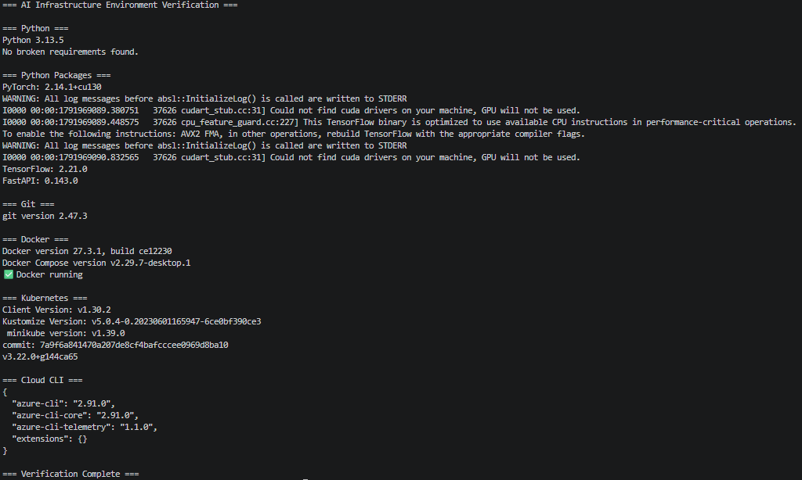
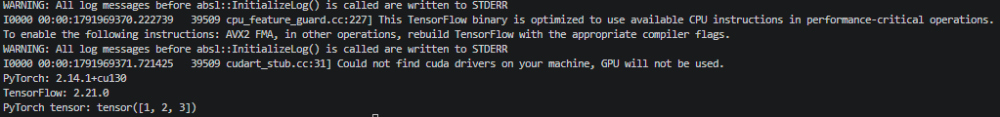
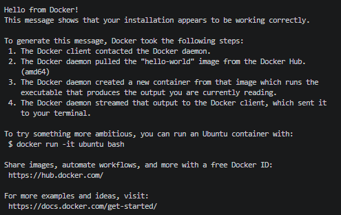
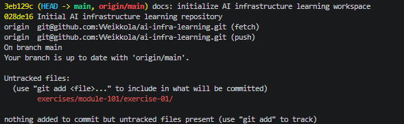
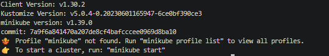

# Exercise 01 – Environment Verification

**Course:** AI Infrastructure Engineer
**Module:** 101 – Foundations
**Source:** [AI Infrastructure Curriculum](https://github.com/ai-infra-curriculum/ai-infra-engineer-learning)

## Objective

Set up and verify a Linux-based development environment for AI Infrastructure Engineering, including Python, machine learning frameworks, containerization,
Kubernetes tools, and Git version control.

## Environment

- OS: WSL2 Debian
- Python: 3.13.5
- IDE: Visual Studio Code
- Containers: Docker Desktop
- Kubernetes: kubectl and Minikube
- Cloud: Azure CLI

## Tasks Completed

- [x] Verified the development environment
- [x] Created and executed a Python script using PyTorch and TensorFlow
- [x] Successfully ran a Docker container
- [x] Initialized Git repository and created first commit
- [x] Captured screenshots

## Verification Results

I executed the environment verification script from the repository root:

./verify-setup.sh

The script checked the Python interpreter, installed packages, Git, Docker, Kubernetes tools, and Azure CLI.

The Python dependency check completed successfully:

No broken requirements found.

PyTorch, TensorFlow, and FastAPI were imported successfully.

Docker, Docker Compose, kubectl, Minikube, Helm, and Azure CLI were detected.

## Challenges and Solutions

During the setup, I encountered issues with Python virtual environment activation, an interrupted TensorFlow download, Docker socket permissions, and GitHub's file
size limit. I resolved these by correcting environment paths, retrying package installations, updating Linux user permissions, and removing unnecessary large files
from Git history.

## Screenshots

### Environment Verification

### ML Frameworks

### Docker

### Git

### Kubernetes

## What I Learned

I learned how to set up and verify an AI infrastructure development environment using Python, Docker, Kubernetes tools, and Git. I also gained practical experience
troubleshooting dependency issues, managing Linux permissions, and using GitHub for version control.